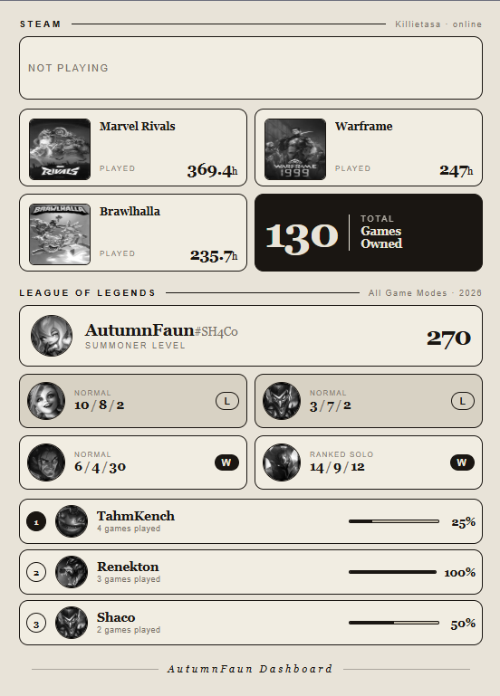
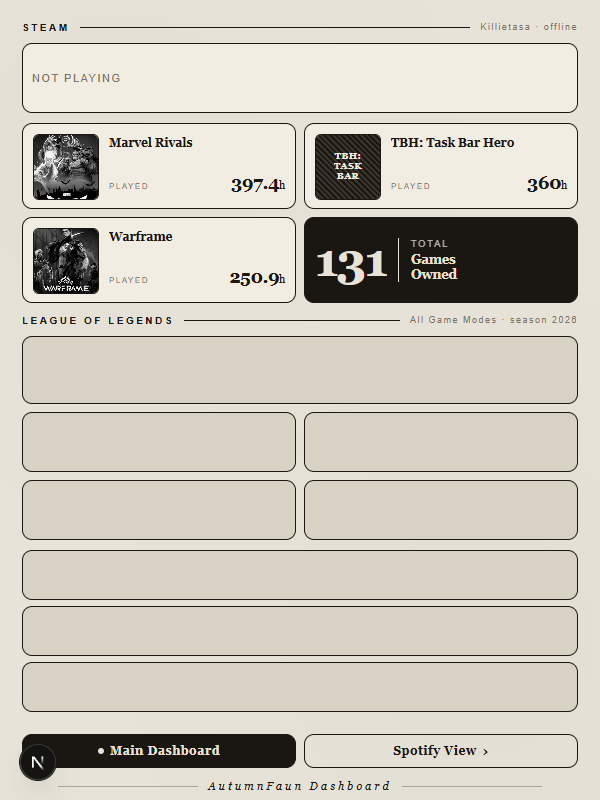

<div align="center">

# AutumnFaun Dashboard

*A personal e-ink dashboard for a Kindle: a KOReader plugin, a TRMNL screen or the built-in web browser*

[](https://nextjs.org)
[](https://www.typescriptlang.org)
[](https://www.docker.com)
[](https://steamcommunity.com/dev)
[](https://developer.riotgames.com)
[](https://developer.spotify.com)

</div>

---

## What is this?

A self-hosted dashboard that turns a **Kindle** into an e-ink status display. The Kindle sits on a desk showing Steam activity, League of Legends stats and what's playing on Spotify, refreshing on its own. With the KOReader plugin it also becomes a small hub you can touch: switch tabs, control Spotify and follow synced lyrics.

The main app is a full React/Next.js dashboard for modern browsers. The Kindle can show it in three ways:

- **[KOReader plugin](#koreader-plugin)** *(interactive)* — a native app on the Kindle with a **Dashboard** tab and a **Spotify** tab (cover, Prev / Play-Pause / Next buttons, synced lyrics). It refreshes more often than the other options and redraws only the part of the screen that changed.
- **[TRMNL + LaraPaper](#trmnl--larapaper)** *(static display)* — a self-hosted [LaraPaper](https://github.com/usetrmnl/larapaper) server renders the dashboard into an e-ink image and the Kindle just displays it.
- **[Fullscreen browser](#the-rendering-challenge--how-to-make-it-work-on-a-kindle)** — a dedicated `/kindle` route serves a zero-JavaScript, pre-rendered HTML page that even the oldest WebKit browser can handle.

### Which one to use

| | KOReader plugin | TRMNL + LaraPaper | Fullscreen browser |
|---|---|---|---|
| **Best for** | An interactive hub: tabs, Spotify controls, live lyrics | A set-and-forget display | Trying it out with the fewest moving parts |
| **On the Kindle** | Jailbreak + KUAL + KOReader + plugin folder | Jailbreak + a TRMNL client | Jailbreak + KUAL + fullscreen browser |
| **On the server** | This app | This app + LaraPaper | This app |
| **Updates** | Dashboard every 60 s; Spotify every 5 s, lyrics line by line | On the device refresh interval (e.g. 60 s) | Whole-page reload (meta refresh) |
| **Screen redraw** | Only the changed region (lyrics box, progress bar) | Whole screen | Whole screen |
| **Touch** | Tabs, swipe, Spotify buttons | None | Links and Spotify buttons (each tap reloads the page) |

<div align="center">



</div>

<div align="center">



</div>

---

## The Rendering Challenge — How to Make It Work on a Kindle

Getting a web app to display correctly on a Kindle is not straightforward. The Kindle Paperwhite ships with an old WebKit-based browser with significant limitations:

- **No modern JavaScript runtime** — React, hydration, and client-side hooks are too heavy for the hardware
- **No reliable CSS Grid / Flexbox** — older browser versions ignore or misrender modern layout CSS
- **Slow CPU and very limited RAM** — even a lightweight JS bundle can freeze or crash the browser
- **Client-side API calls are a problem** — fetching multiple external APIs from the browser adds latency on already sluggish hardware, and any JS error kills the whole page

### Approaches Considered

| Approach | Pros | Cons | Verdict |
|---|---|---|---|
| **Regular React page** | Already built | Too heavy for Kindle; JS crashes | ❌ |
| **PNG screenshot (Puppeteer)** | Perfect visual match | Requires headless Chrome on server; heavy dependency | ❌ |
| **Next.js ISR** | Static-ish output | Still ships a React bundle the Kindle has to execute | ❌ |
| **Pure HTML route** | Zero JS, works on any browser | No interactivity (acceptable for a dashboard) | ✅ |
| **Native KOReader plugin** | Real widgets, touch, partial e-ink refresh; no browser at all | Needs KOReader on the Kindle | ✅ see [KOReader plugin](#koreader-plugin) |

### The Solution

A dedicated `/kindle` route handler that:

1. **Fetches all data server-side** using a TTL cache (`STEAM_UPDATE_RATE`, `LEAGUE_UPDATE_RATE`) so the Kindle browser never makes a single external API call
2. **Renders a complete HTML string** with inline styles, `<table>`-based grids, and fixed-pixel image dimensions — no CSS classes, no external stylesheets, no JavaScript
3. **Returns `text/html`** with a `<meta http-equiv="refresh">` tag so the page auto-reloads at the configured interval
4. **Proxies all images** through `/api/image-proxy`, which converts them to grayscale PNG on the server with Sharp — the Kindle e-ink display only shows grey anyway
5. **Uses relative image URLs** (`/api/image-proxy?url=...`) so images always resolve correctly regardless of how the server is accessed — localhost in dev, LAN IP in Docker, behind a reverse proxy, etc.

The visual design matches the React dashboard component-by-component — same color palette, same typography, same layout — rendered as static HTML instead of React.

### Pages

A bar at the top switches between the two pages with plain links:

| Page | What it shows | Reloads every |
|---|---|---|
| **`/kindle`** | Steam + League dashboard. While a track plays, the bar shows *♪ track · artist* (tap it to open the player). | `min(STEAM_UPDATE_RATE, LEAGUE_UPDATE_RATE)` s |
| **`/kindle/spotify`** | Spotify player: album cover, progress, the current lyric line with the lines around it, and **PREV / PLAY-PAUSE / NEXT** buttons. | 5 s while playing (`?r=10` sets another interval, 2–600), 30 s while paused, and right when the track ends |

The buttons are HTML forms: a tap posts the command to `/kindle/spotify/control`, which sends it to
Spotify (Premium required) and redirects back to the player, so they work without JavaScript. Each
reload redraws the whole e-ink screen, so lyrics move one step per reload; a longer `?r=` saves battery.

The small **JS** marker next to the title appears only if the browser runs JavaScript, which tells
whether a smoother, script-driven player is possible on that Kindle.

### Kindle Setup

> **Prerequisite:** The Kindle must be jailbroken to install the fullscreen browser. The steps below assume you've already got the server running locally or via Docker.

1. **Get the server running** — follow the [Running Locally](#running-locally) or [Running with Docker](#running-with-docker) steps below until the dashboard is accessible at `http://localhost:3000` or your LAN IP (with Docker, set `HOST_BIND=0.0.0.0` in `.env` for LAN access).

2. **Jailbreak your Kindle** — ([video walkthrough](https://youtu.be/l4ZliC82RtA?si=FmbEArpWFKxcYqRo) · [jailbreak documentation](https://kindlemodding.org/kindle-models.html))
   My device was on firmware **5.18.1** and I used [**AdBreak**](https://github.com/notmarek/adbreak) to jailbreak it.

3. **Install KUAL and the Fullscreen Web Browser** — after jailbreaking and installing KUAL, download the fullscreen browser extension:
   [https://kindlemodshelf.me/fullscreenweb](https://kindlemodshelf.me/fullscreenweb)

4. **Configure the URL** — edit `shortcut_browser.sh` inside the downloaded package and replace the example URL with your server address:
   ```
   YOUR_SERVER_IP:3000/kindle
   ```

5. **Copy files to the Kindle** — connect the Kindle via USB and copy the browser files into the `documents` folder at the root of the device.

6. **Launch** — open the Kindle, tap **"Shortcut Browser"** in KUAL, and the dashboard loads fullscreen.

---

## TRMNL + LaraPaper

[TRMNL](https://trmnl.com/) is an e-ink dashboard platform. Instead of TRMNL's cloud, this project uses
[**LaraPaper**](https://github.com/usetrmnl/larapaper), a self-hosted TRMNL server, so everything runs on your own machine.

```
Kindle (TRMNL client) ──every N s──► LaraPaper ──polls──► this app's /api/trmnl (JSON)
        ▲                                │
        └──────── 600×800 PNG ◄──────────┘ renders trmnl-plugin/template.html
```

1. LaraPaper polls `/api/trmnl` for JSON (Steam + League + Spotify).
2. It renders the Liquid template [`trmnl-plugin/template.html`](trmnl-plugin/template.html) into a PNG sized for the Kindle (no e-ink browser limitations).
3. The Kindle's TRMNL client downloads and shows the image on its refresh interval.

The image is static: no buttons, and it changes only when the device refreshes. For an interactive
screen, use the [KOReader plugin](#koreader-plugin) (see [Which one to use](#which-one-to-use)).

**Full setup** (installing LaraPaper, the Kindle device model, the plugin, refresh intervals and troubleshooting):
[`trmnl-plugin/README.md`](trmnl-plugin/README.md).

---

## KOReader plugin

[KOReader](https://github.com/koreader/koreader) is an open-source e-book reader that runs on
jailbroken Kindles and has a Lua plugin system with native widgets, touch input and control over how
the e-ink panel refreshes. [`koreader-plugin/kindledash.koplugin`](koreader-plugin/) uses it to turn
the Kindle into a small hub, without the limits of the Kindle browser (no JavaScript, full-page reloads).

It opens full screen with a tab bar (**Dashboard**, **Spotify**, **Close**); switch tabs with the
buttons or by swiping left/right.

- **Dashboard** — Steam + League with the same look as `/kindle`. This app renders it as a grayscale
  PNG sized to the screen (`/api/kindle/dashboard.png`, built with `next/og`) and the plugin downloads
  it every 60 s (configurable, minimum 15 s).
- **Spotify** — album cover, track, progress bar, **Prev / Play-Pause / Next** buttons and synced
  lyrics. The plugin polls `/api/spotify` every 5 s and a local clock moves the lyrics between polls:
  each line change redraws only the lyrics box, so the screen doesn't flash on every line.

```
Kindle (KOReader + kindledash.koplugin)            this app
  Dashboard tab ── every 60 s ───────────────────► /api/kindle/dashboard.png?w=&h=
  Spotify tab   ── every 5 s ────────────────────► /api/spotify
                ── once per track ───────────────► /api/spotify/lyrics, /api/image-proxy (cover)
                ── on tap ───────────────────────► POST /api/spotify/control
```

**Install** (after the jailbreak and KUAL, see [Kindle Setup](#kindle-setup)):

1. Download `koreader-kindlepw2-*.zip` from the [KOReader releases](https://github.com/koreader/koreader/releases)
   (covers the Kindle 10th gen, Paperwhite 2 and newer), unzip it at the root of the Kindle and start
   KOReader from KUAL.
2. Copy the `koreader-plugin/kindledash.koplugin` folder into `koreader/plugins/` on the Kindle and
   restart KOReader.
3. Open **Tools → Kindle Dashboard → Open dashboard**. Set your server under **Server** in the same menu.

The plugin updates only while the Kindle is awake: to leave it running as a hub, turn off KOReader's
autosuspend and keep the Kindle plugged in (Wi-Fi stays on). Settings, gestures, troubleshooting and
development notes: [`koreader-plugin/README.md`](koreader-plugin/README.md).

---

## Features

| Section | Details |
|---|---|
| 🎮 **Steam** | Online status · Now Playing card with game art (*Last played* on the TRMNL screen when not in game) · Top 3 games with hours played · Total library count |
| 🏆 **League of Legends** | Summoner profile · Last 4 matches with queue type, KDA and W/L badge · Top 3 champions with winrate bar |
| 🎵 **Spotify** | Current (or last played) track with album art · player with synced lyrics and controls in the KOReader plugin, on `/kindle/spotify` and at `/spotify` |
| 💾 **Saved data** | Last successful Steam/League/Spotify data is kept on disk; a failed API call never blanks the screen |

---

## Spotify

Spotify appears in five places:

| Where | What it shows |
|---|---|
| **TRMNL screen** (`/api/trmnl`) | Album cover, track and artist. *Now playing* while a track plays; when playback stops it keeps the *Last played* track (saved on disk, so it survives restarts). |
| **`/kindle`** | *♪ track · artist* in the top bar while a track plays. |
| **`/kindle/spotify`** | Zero-JavaScript player for the Kindle browser: cover, current lyric lines and previous / play-pause / next buttons, reloading every 5 s (see [Pages](#pages)). |
| **KOReader plugin** | Spotify tab: cover, synced lyrics and playback buttons (see [KOReader plugin](#koreader-plugin)). |
| **`/spotify`** | Full player in a modern browser: live progress, lyrics ([LRCLIB](https://lrclib.net), synced or plain) and previous / play-pause / next controls. Shows the last played track when nothing is playing. |

The TRMNL screen is a static image, so it cannot have playback buttons, and it changes only when the Kindle refreshes
(a 60 s refresh interval follows track changes within about a minute). For controls on the Kindle, use the
KOReader plugin or `/kindle/spotify`; in a modern browser, `/spotify`.

Playback controls need **Spotify Premium** and an active device (a Spotify app that is playing or was recently playing); otherwise the player shows Spotify's error under the controls.

Connecting your account needs a one-time OAuth authorization that produces `SPOTIFY_REFRESH_TOKEN` —
see [Spotify keys](#spotify-keys) below.

---

## Tech Stack

- **Next.js 16** — App Router, route handlers, standalone Docker output
- **TypeScript** — strict mode throughout
- **Tailwind CSS v4** — main dashboard styling
- **Sharp** — server-side grayscale image conversion via `/api/image-proxy`
- **Steam Web API** — player summary, owned games, now playing
- **Riot Games API** — account lookup by Riot ID, match history, summoner data
- **Data Dragon** — champion images and profile icons
- **Spotify Web API + LRCLIB** — currently playing track, synced lyrics
- **Docker** — multi-stage build with Sharp native binaries for Alpine
- **LaraPaper** — self-hosted TRMNL server that renders the e-ink screen
- **GitHub Actions** — deploys to the production server on every push to `master`

---

## Running Locally

```bash
# 1. Install dependencies
npm install

# 2. Fill in environment variables
cp .env.example .env   # edit .env with your API keys

# 3. Start the dev server
npm run dev
```

| URL | Description |
|---|---|
| `http://localhost:3000` | Main React dashboard |
| `http://localhost:3000/kindle` | Kindle-optimized static HTML view |
| `http://localhost:3000/spotify` | Full Spotify player |
| `http://localhost:3000/api/trmnl` | JSON payload for the TRMNL / LaraPaper plugin |
| `http://localhost:3000/api/kindle/dashboard.png` | Dashboard image for the KOReader plugin (`?w=&h=` to size it) |
| `http://127.0.0.1:3000/api/spotify/auth` | Start Spotify OAuth flow (use `127.0.0.1`, see [Spotify keys](#spotify-keys)) |

## Running with Docker

```bash
docker compose build
docker compose up -d
```

The server listens on `127.0.0.1:3000`. Set `HOST_PORT` in `.env` to use another port, and `HOST_BIND=0.0.0.0` to reach it from other devices on the LAN (e.g. the Kindle browser at `http://<host-ip>:3000/kindle`); on a public server keep the default and put a reverse proxy in front.
Successful API responses are saved in the `cache` volume (`/app/.cache`), so the last good data survives restarts and deploys.

## Deploying (GitHub Actions)

[`.github/workflows/deploy.yml`](.github/workflows/deploy.yml) deploys on every push to `master` (or manually via *Run workflow*):
it SSHes into the server, resets the checkout to `origin/master`, rebuilds and restarts the container, and checks that the app answers.

One-time server setup:

1. Clone the repo on the server and create its `.env` (same variables as below, plus `HOST_PORT`, e.g. `3400`). The `.env` is not in git — edit it on the server when a key changes, then run `docker compose up -d`.
2. Add a reverse proxy site for the app (nginx + `certbot --nginx`), proxying to `127.0.0.1:$HOST_PORT` with the `Host` and `X-Forwarded-Proto` headers (the Spotify callback URL is built from them).
3. Create an SSH key for the workflow, add its public key to the server's `~/.ssh/authorized_keys`, and set these repository secrets:

| Secret | Value |
|---|---|
| `SERVER_HOST` | Server IP or hostname |
| `SERVER_USER` | SSH user |
| `SERVER_SSH_KEY` | The workflow's private key |
| `SERVER_PATH` | Absolute path of the checkout on the server |

> If Docker on the server is installed via **snap**, its AppArmor profile blocks DNS for the buildx client, so registry lookups during `docker build` fail. The workflow works around it by pulling the base images with `docker pull` first.

---

## Environment Variables

| Variable | Description | Default |
|---|---|---|
| `STEAM_API_KEY` | Steam Web API key | — |
| `STEAM_ID` | Your Steam 64-bit ID | — |
| `LEAGUE_API_KEY` | Riot Games API key *(dev keys expire every 24 h)* | — |
| `RIOT_ID` | Your Riot ID in `Name#TAG` format | — |
| `SPOTIFY_API_CLIENT_ID` | Spotify app client ID | — |
| `SPOTIFY_API_CLIENT_SECRET` | Spotify app client secret | — |
| `SPOTIFY_REFRESH_TOKEN` | OAuth refresh token *(obtained via `/api/spotify/auth`)* | — |
| `LRCLIB_API_URL` | LRCLIB lyrics API base URL | `https://lrclib.net/api/` |
| `STEAM_UPDATE_RATE` | Steam cache TTL and Kindle refresh interval (seconds) | `60` |
| `LEAGUE_UPDATE_RATE` | League cache TTL (seconds) | `600` |
| `HOST_PORT` | Docker only: host port published by `compose.yaml` | `3000` |
| `HOST_BIND` | Docker only: host address the port is published on (`0.0.0.0` for LAN access) | `127.0.0.1` |
| `CACHE_DIR` | Where the last good API data is saved | `.cache` |

> **Riot API note:** development keys expire every 24 hours. The app resolves accounts by Riot ID (`Name#TAG`) via the Account API — no encrypted summoner ID needs to be stored or updated when the key rotates.

---

## Getting the API keys

### Steam keys

1. **`STEAM_API_KEY`** — sign in at [steamcommunity.com/dev/apikey](https://steamcommunity.com/dev/apikey), enter any domain name (e.g. your server's), accept the terms and copy the key. The account must not be a limited account (it needs at least US$5 spent on Steam).
2. **`STEAM_ID`** — your 64-bit SteamID (17 digits, starts with `7656119`). If your profile URL is `steamcommunity.com/profiles/7656119…`, it is that number; if it uses a custom name, look it up at [steamid.io](https://steamid.io).
3. In Steam, **Edit Profile → Privacy Settings**: set *My profile* and *Game details* to **Public**, otherwise owned games and playtime come back empty.

### Riot keys

1. **`LEAGUE_API_KEY`** — sign in at [developer.riotgames.com](https://developer.riotgames.com) with your Riot account. The dashboard shows a **Development API Key**; copy it.
   - Development keys **expire every 24 hours**: click *Regenerate API Key* and update the `.env` (on the server too).
   - Limits are 20 requests/second and 100 requests/2 minutes. A League refresh uses ~23 requests, so the app fetches matches one at a time, caches the result for `LEAGUE_UPDATE_RATE` seconds and backs off for 2 minutes after a failure.
   - For a key that does not expire, apply for a **Personal API Key** via *Register Product* on the developer portal.
2. **`RIOT_ID`** — your Riot ID as shown in the client, in `Name#TAG` format (e.g. `AutumnFaun#SH4C0`).

> Regions are fixed in [`src/lib/league.ts`](src/lib/league.ts): `br1` for summoner data and `americas` for account/match data. Change `BR1_BASE` / `AMERICAS_BASE` if your account is in another region.

### Spotify keys

1. Go to the [Spotify Developer Dashboard](https://developer.spotify.com/dashboard) → **Create app**:
   - **Redirect URIs** — add one for each place you will authorize from:
     - local: `http://127.0.0.1:3000/api/spotify/callback` (Spotify does not accept `localhost`, only the loopback IP)
     - server: `https://YOUR_DOMAIN/api/spotify/callback`
   - **APIs used**: *Web API*.
2. Open the app's **Settings** and copy **Client ID** → `SPOTIFY_API_CLIENT_ID` and **Client secret** → `SPOTIFY_API_CLIENT_SECRET`.
3. While the app is in *Development mode*, add your Spotify account's e-mail under **User Management**.
4. Start the app and open `/api/spotify/auth` **on the same host as the redirect URI** (`http://127.0.0.1:3000/api/spotify/auth` locally, `https://YOUR_DOMAIN/api/spotify/auth` on the server). Log in and accept.
5. The callback page shows `SPOTIFY_REFRESH_TOKEN=…` — put it in `.env` and restart the app (`docker compose up -d` on the server). The token does not expire; repeat only if you revoke access or change the app.

### LRCLIB

`LRCLIB_API_URL` needs no key — [LRCLIB](https://lrclib.net) is a free lyrics API (used by `/spotify`, `/kindle/spotify` and the KOReader plugin).

---

## Roadmap

- [x] Spotify on the e-ink screen — current / last played track on the TRMNL screen
- [x] Data persistence — last successful API responses are saved, so failures and restarts never blank the dashboard
- [x] Partial screen update — the KOReader plugin redraws only the changed region (lyrics box, progress bar) instead of the whole screen
- [x] Interactive Kindle hub — KOReader plugin with tabs, Spotify controls and synced lyrics

---

<div align="center">

*Built for a Kindle sitting on a desk*

</div>
